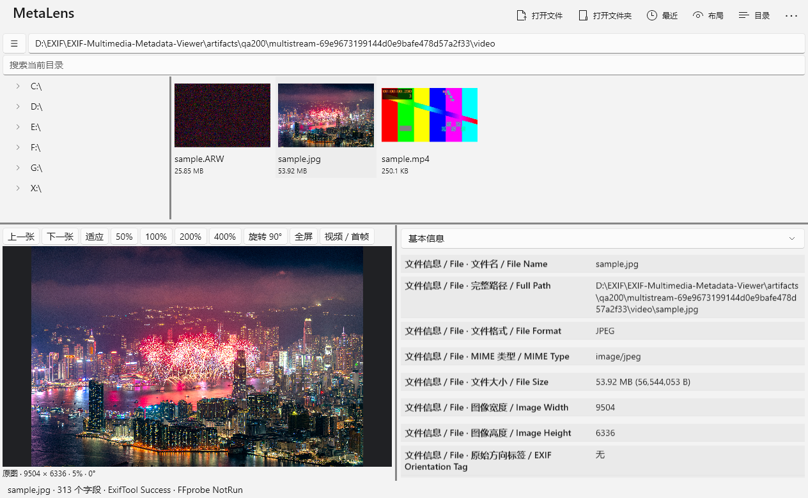
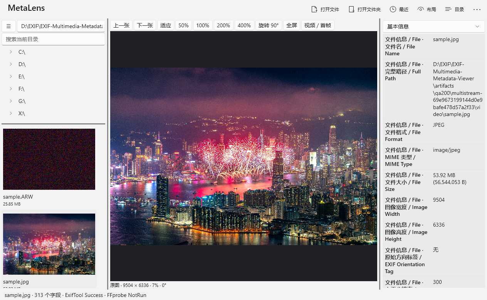
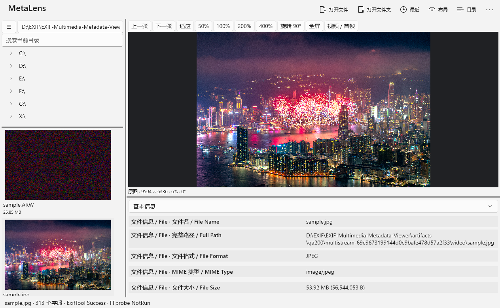

# MetaLens 2.0.0：WinUI 3 本地交付与验收

2026-11-22，Windows 10 专业工作站版 22H2 x64（19045）。WPF 对照为 v1.2.2；正式交付为 `releases/v2.0.0/build.4`。这是一份可以安装、离线运行的原生桌面应用。结论适用于下面列出的机器、样片和操作，不是对所有 RAW、系统编解码器和 DPI 组合的承诺。

## 版本与技术路线

| |v1.2.2|v2.0.0 build.4|
|---|---|---|
|源码|`v1.2.2-layout` / `659b88d`|程序 `f55a698ffd6d48cff4825b43ab5dc83f18ad6e5f`；交付标签 `v2.0.0` 另含本文、测试与截图|
|宿主与视图|WPF、WindowsDesktop、XAML|C#、WinUI 3 原生 XAML、Windows App SDK WinUI / Runtime 2.7.0（包内 `Release.Channel=stable`），无网页或 WPF 外壳|
|状态、预览、数据|WPF ViewModel、图像视口及自定义虚拟面板|业务模型及服务与视图分离；原生 GridView/ListView、BitmapDecoder、MediaPlayerElement；保留 HWND/指针等视图专属操作|
|解析、汇总与导出|独立 .NET 内核、ExifTool、FFprobe|同一内核、同版本工具；仅纠正共享 GPS 摘要符号，不重写、不去重、不筛掉未知字段|
|部署|x64 独立发布和 EXE 安装器|.NET SDK 10.0.403 构建，携带 .NET 10.0.14 与 Windows App SDK；Inno Setup 按用户安装，无 MSIX。编译目标 Windows SDK 26100、最低声明 19041，不等于两者都经过实机验证|

[项目结构、构建和回退步骤](../../README.md) · [功能迁移矩阵](../../MIGRATION_MATRIX.md) · [更新记录](../../CHANGELOG.md)。旧 WPF 源树仍在；与 `659b88d` 相比，旧项目只有 `MetadataSummaryBuilder.cs` 的 GPS 修复，`ExifMetadata.Core` 没有差异。原 v1.2.2 EXE/安装包未覆盖。

## 三种布局与真实工作区

以下为 build.4 运行时渲染的 WinUI 客户区，均选中同一张 JPEG；视频卡片是合成四流测试片。点击查看原尺寸：

|原版：目录在上|三栏：目录、预览、信息|双层：目录在左，右侧上下排列|
|---|---|---|
||||

[深色双层布局](screenshots/dark-stacked.png)。三种模式共享浏览器、预览、元数据对象；在同一目录打开 JPEG/ARW/MP4 后切换模式，计数保持 1 次扫描、3 次解析。另做 30 次切换和 13 次快速选择，最后 JPEG 的画面与字段一致。9 个分隔位置用实际调整函数改值后跨进程恢复；非人工把 9 条都拖了一遍。[工作区](evidence/workspace.json) · [重启恢复](evidence/restore.json)。

## 图片、视频与右键

- 最终包真实预览：JPEG **9504×6336**，100% 时物理宽度为 9504，200% 为 19008；Sony ARW 解码 **6272×4180**。固定 UI 目录的三文件分别显示 313、25,699、228 项；不是下表中六份原片的同一路径。PNG 竖图 360×640、TIFF 横图 1024×512、DNG 960×640、NEF 6016×4016，实测 50/100/200/400% 和 90° 旋转；这四份只测一次的预览解码时间依次为 109/22/617/371 ms。RAW 标注实际系统解码或内嵌图，不把内嵌尺寸当作传感器分辨率。[预览记录](evidence/media.json) · [格式记录](evidence/formats.json)。
- MP4 的 FFmpeg 预览为 1600×900；切到原生播放器后从零前进 0.2124 s，测试暂停、跳至 1 s。另用 4 s 合成片验证 1 路 MPEG-4 视频、2 路 AAC 音频、1 路 `mov_text` 字幕；两版均 370 个字段（ExifTool 170、FFprobe 200），JSON/CSV 各 370。播放器实际前进 0.237 s 并暂停、跳转。[四流媒体记录](evidence/multistream-media.json) · [可复跑测试](../../tests/Test-WinUIMultistream.ps1)。识别流与真正切换音轨、渲染字幕不是同一个测试。
- 在同次迁移的首个 v2 包上人工点验：目录筛选 `MP4` 后只见视频，清空恢复三项；「上级」和「返回」切换实际路径；右键「打开方式」进入原生 EXE 选择器并可取消。另点验原图细节、平移、横滚和 F11/Esc。最终包的程序内测试用专用 helper 确认中文带空格路径作为**一个**参数传入，缺失 EXE 被拒绝。没有调用用户私人编辑器或更改系统关联。[外部打开记录](evidence/external.json)。

## 新旧元数据逐字段对照

同机分别调用两套发行目录中的工具，交给相同的分析内核，比较字段身份、出现次数、值和来源；检查导出的 JSON 字段数及按 CSV 引号规则读取的记录数。下表每行的「字段」同时是两版数量、JSON 项数和 CSV 记录数；各解析时间是单次测量，不足以推断算法提速。

|实样|字段|ExifTool + FFprobe|v1.2.2 / v2.0.0 用时（ms）|
|---|---:|---:|---:|
|Sony JPEG|313|313 + 0|371 / 389|
|Sony ARW|25,713|25,713 + 0|4023 / 4190|
|Nikon NEF|17,779|17,779 + 0|2910 / 2742|
|DJI DNG|213|213 + 0|388 / 305|
|Sony MP4|362|211 + 151|350 / 352|
|DJI MP4|358|164 + 194|403 / 357|
|**合计**|**44,738**| | |

其中五份仅 `FileAccessDate` 随系统读取变化，Sony MP4 连该项也相同；除该时间外**没有字段差异**。照片不启动 FFprobe。测了 MakerNotes、跨组同名字段、原始 JSON、视频叶节点、中文路径及防覆盖导出；损坏 JPEG 明确报部分结果。此表是分析内核与随包工具的对照，WinUI 控件另有上节三文件实测。[对照测试源码](../../tests/ExifMetadata.IntegrationTests/Program.cs)。不发布私人样片、完整元数据值或注册表值。

GPS 另用四张已知坐标的合成 JPEG：东北 **12.5°, 30.25°**，西南 **−12.5°, −30.25°**，零点 **0°, 0°**，无坐标显示「无」。在真实摘要控件读取十进制、DMS 与来源；修复旧实现把 `East` 中的字母 `s` 当作南向而错误加负号的问题。ExifTool 只为本测试写入新生成的合成图，不写用户媒体。[GPS 结果](evidence/gps.json) · [测试脚本](../../tests/Test-WinUIGps.ps1)。

## 性能与 Explorer

2026-11-22 同机、空窗口、各自从空测试配置开始，同版顺序启动 5 次，各列独立取中位，不清 OS 文件缓存。主窗为首次取得窗口句柄，响应为首次检测到窗口响应，不代表已加载一张大图。窗口出现后等待 6 s，再用 1 s 采样计算全机归一的该进程 CPU；单次 0 不代表长期 CPU 必为零。[v1.2.2 原表](evidence/startup-1.2.2.csv) · [最终 v2 原表](evidence/startup-2.0.0.csv)。

|空启动中位|主窗 ms|响应 ms|CPU %|工作集 MiB|私有 MiB|线程|句柄|直接子进程|
|---|---:|---:|---:|---:|---:|---:|---:|---:|
|v1.2.2|834.0|976.9|0|165.79|123.77|31|910|0|
|v2.0.0 build.4|590.4|597.8|0|182.79|129.59|74|1433|0|

最终包枚举 1000 个文件 **550 ms**、1 次扫描，13 个滚动位置实际生成 13–36 个容器，未为每个文件保留 UI。这里计到**条目枚举完成**，不是一千张缩略图全部生成。[千文件诊断](evidence/browser.json)。

为检验枚举完成后的实际负担，用两个**最终发行目录**分别打开千文件目录中同一张 56,544,053 B JPEG。每版从空测试配置开始连续 3 次，出现响应窗口后等待 9 s 再取 1 s CPU 样本；随后沿用该缓存各起一次，把采样点移至 30 s。界面均为默认布局，没有强令两种框架生成相同数量的卡片。

|大目录采样|CPU %|工作集 MiB|私有 MiB|线程|句柄|
|---|---:|---:|---:|---:|---:|
|[v1.2.2，9 s，三次中位](evidence/large-1.2.2.csv)|0|461.58|646.80|36|951|
|[v2.0.0 build.4，9 s，三次中位](evidence/large-2.0.0.csv)|18.856|573.48|510.61|101|2429|
|[v1.2.2，30 s，热缓存一次](evidence/large-settled-1.2.2.csv)|0|439.28|630.37|25|906|
|[v2.0.0 build.4，30 s，热缓存一次](evidence/large-settled-2.0.0.csv)|0|581.84|519.06|86|1774|

最终版在大目录打开早期的 CPU 和工作集高于旧版，热缓存较晚采样时 CPU 回落；私有内存低于旧版，线程和句柄仍较多。以上八次大目录测试的 Explorer 在前后采样点均响应，直接子进程采样均为零。这不能证明测量间隔内没有短暂停顿，或资源占用已全面达到 v1.2.2 水平。

另外保留了可访问性和长时间测试，避免把不同方法混为一组：

- 同目录打开大 JPEG 后的首个可访问浏览项，v1.2.2 / 首个 v2 包分别为 3021.2 / 1531.3 ms（各一次）。当时的工作集为 464.75 / 566.18 MiB，私有内存 647.48 / 504.02 MiB，线程 38 / 99，句柄 984 / 3294；该采样点不等于空闲，亦不可与 build.4 的 550 ms 相减。[旧版原表](evidence/final-browse-1.2.2.csv) · [首个 v2 包原表](evidence/final-browse-2.0.0.csv)。
- 首个 v2 包持续 925.4 s（15 分 25 秒）内采样 30 次，应用与 Explorer 在采样点均响应，直接子进程均为 0；工作集从 632.25 降至 556.49 MiB、私有内存从 591.91 降至 511.31 MiB。不能据此断言数小时无泄漏。[长时间原表](evidence/soak.csv)。
- WPF 的 JPEG 首显、100%、200%、JPEG→RAW 的一次端到端计时分别为 2962/1041/866/6459 ms。v2 已实测实际像素、解码与切换正确性，未收集同一端到端口径的上述四项，不把解码调用计时充当交互提速。

资源约束：目录每批 64 项；文件树 2 路；缩略图 3 路、192 项内存 LRU、512 MiB/30 天磁盘缓存；元数据 1 路、4 项；大图主预览 1 路，仅缓存至多两张不超过 4,194,304 像素的图；快速切换取消陈旧请求，设置写入防抖 600 ms。限制的是本应用的工作队列，不是对 Windows 或解码器线程总数的限制。

## 包体与许可证

安装包 **102,907,981 B（98.14 MiB）**，v1.2.2 为 101,449,395 B（96.75 MiB）。增加 **1,458,586 B（1.39 MiB，1.44%）**，没有达到「比旧版更小」。两版均无 PDB；v2 去除 WPF，保留真实相机表、编码库及 x64 自包含运行时，未启用单文件或未经验证的裁剪。

|随包内容（字节；互斥口径）|v1.2.2|v2.0.0 build.4|
|---|---:|---:|
|应用、apphost、Core 与项目配置|453,827|742,833|
|ExifTool 和 Perl 数据|32,002,076|32,002,076|
|FFmpeg / FFprobe 可执行文件|551,424 / 269,824|551,424 / 269,824|
|七个媒体共享库|157,814,784|157,814,784|
|FFmpeg 许可与构建信息|10,697|10,697|
|基础 .NET 运行时|80,358,144|80,374,352|
|WPF WindowsDesktop|57,135,384|0|
|Windows SDK 投影|0|26,870,352|
|独立归集的微软/运行时许可、NOTICE、版本文件|0|1,201,630|
|其余运行库、本地化、WinAppSDK 及其他资产（余额，非单个 DLL）|608,938|71,565,027|
|**app 目录**|**329,205,098（771 文件）**|**371,402,999（988 文件）**|
|**app + 安装包 + BUILD-INFO**|**430,654,974**|**474,311,561**|

主 EXE 是 apphost（162,816 → 288,256 B），不是整个应用；最终 WinUI 托管 DLL 为 356,864 B。ExifTool 13.59 按 Perl 的 GPL/Artistic 条款分发，保留 Perl 许可和数据文件，仅排除独立 API 手册 `.pod`；FFmpeg/FFprobe 为 BtbN `n9.0.2-36-g6882969ce9-20261027` LGPL-3.0-or-later 共享构建。.NET 10.0.14 的 MIT 与第三方许可，WindowsAppSDK 各包和传递的 WebView2 loader 的许可与 NOTICE 均随应用提供；UI 不依赖网页呈现。Windows SDK BuildTools 10.0.26100.9457、Inno Setup 为构建工具，不作为独立工具分发。[完整依赖说明](../../third_party/THIRD-PARTY-NOTICES.md)，另见发行 `app/licenses` 与 `app/tools`。

|最终文件|SHA-256|
|---|---|
|v2.0.0 build.4 安装器（未签名）|`91FC98156A20D5B540343A4D3609B9300C63FB645A08E1537F1B2AA546405D0D`|
|v2.0.0 主 EXE|`81BF808CE33650974D5408BC4642FC0464DC02DB34633F6D753617D312C914AE`|
|v2.0.0 WinUI DLL|`166D9ACD3F2F3DADE0E985C0EDAC616CA9C72BA0762704C30C3DAE0AD4BA9F45`|
|对照 v1.2.2 安装器|`FE1C3282C8FE18462DAC2E5B1F905833AA1F8D80EE2EF18F93175C5723C910B6`|

隔离的中文含空格目录完成**安装 → 988 个文件逐一比对 SHA-256 → 安装后运行 JPEG/RAW/视频 → 重装并再验 → 卸载**。卸载后未遗留被测 EXE、卸载注册项或快捷方式；对 `.jpg/.jpeg/.png/.arw/.nef/.dng/.mp4` 比较前后 UserChoice，均未改变。[安装证据](evidence/installer.json) · [复验脚本](../../tests/Test-WinUIInstaller.ps1)。再次向 `build.4` 运行发布和打包脚本，两者均拒绝覆盖，安装器哈希未变。

## 尚未验收或存在差异的事项

- 未在 Windows 11、最低声明的 Windows 10 19041、混合 DPI 或无 RAW 扩展的干净机器上复验。RAW 展示系统能解码的图或提取的内嵌图，不提供完整传感器显影器。深浅主题可选，未另加自动跟随系统模式。
- 有源码路径但未逐手势验完的项目包括目录树各分支、拒绝访问与断开的卷、拖入和最近文件的各入口、全部键盘焦点组合、九个分隔位置的实际鼠标拖动、系统剪贴板独立读回。详见矩阵，不以程序内调用冒充人工点击。
- 未验证所有编解码器、MOV、章节、实际切换音轨及字幕叠字；未取得所有缩略图完成时间、两版同口径高清切换/缩放端到端成绩或数小时稳定性结论。安装包和部分运行资源指标高于旧版。
- Git 留有可回退的骨架、迁移、发布、修复节点，保留旧发行和本轮迭代包，但没有 12 个阶段各自独立的完整构建与测试记录。本地验收与 GitHub 发布是不同事项。
